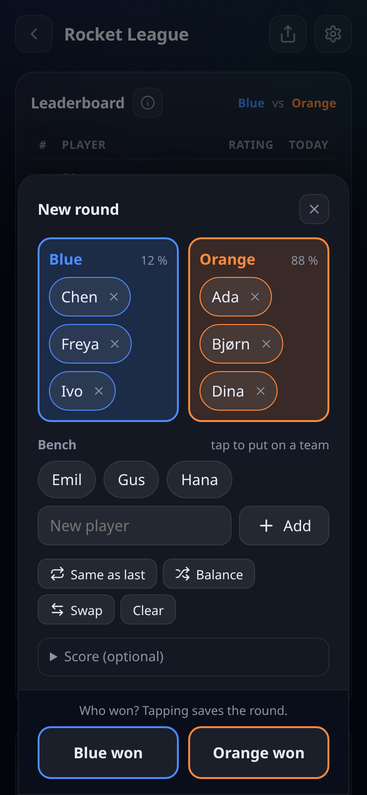
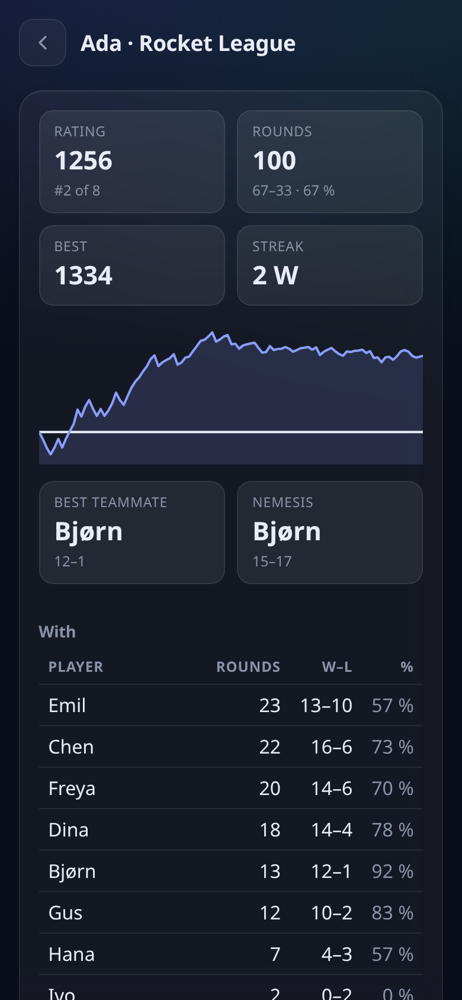
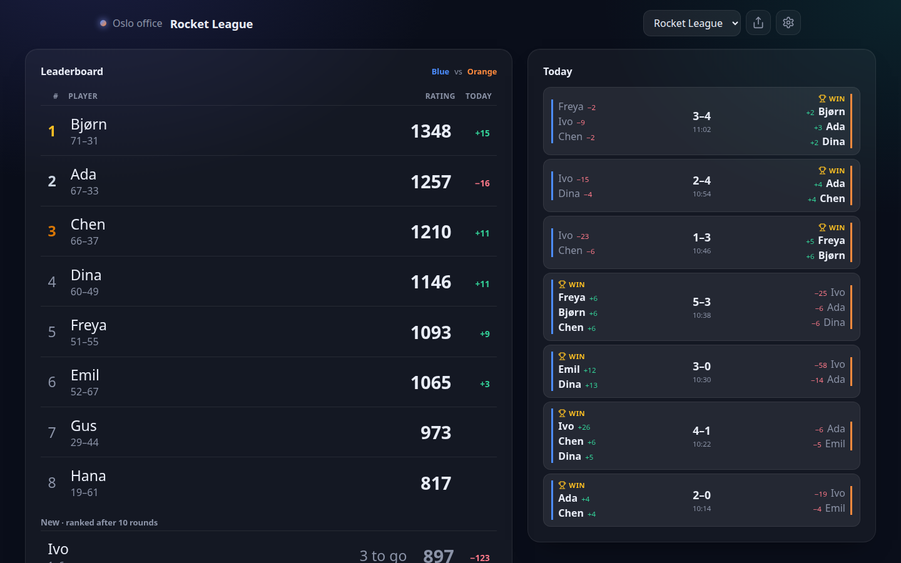
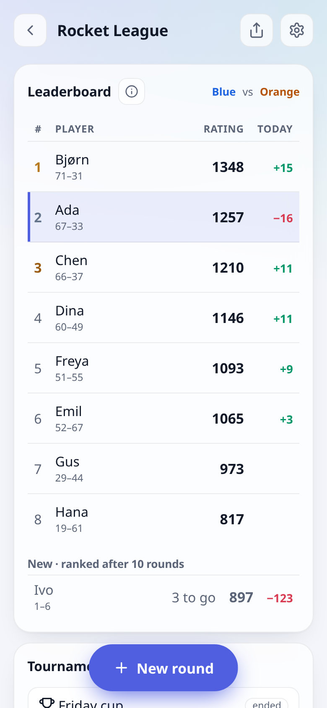
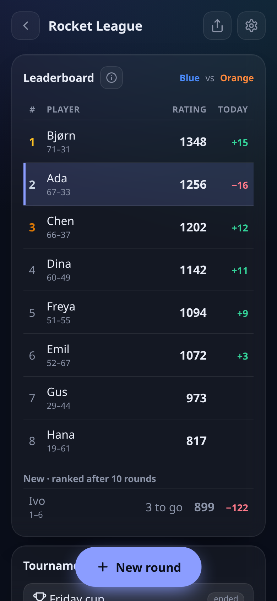
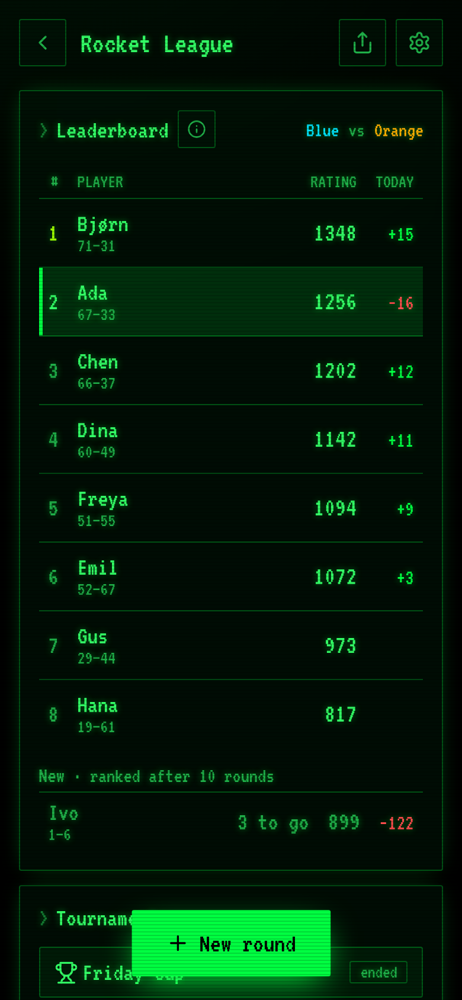
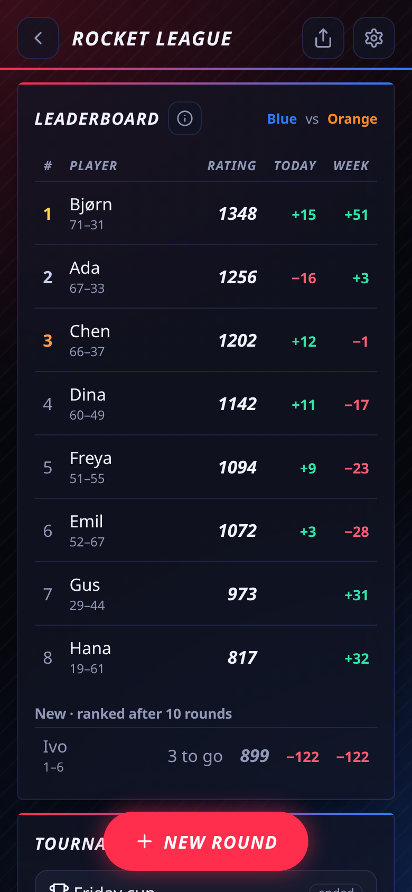

# Scoreboard

Self-hosted score keeping with fair team ratings, for the office's daily
Rocket League, the table tennis ladder, or anything else with two teams.
Log a round on your phone in a couple of taps; the leaderboard, win odds and
a wall-screen dashboard update themselves. One Go binary with the web app
inside, SQLite for storage, no accounts.

<p align="center">
  
  
  
</p>

## Features

- **Fair ratings for teams.** Weng-Lin (Bradley-Terry), a TrueSkill-style model
  built for teams. Uneven teams (2 against 1) work: the app learns how much the
  extra player is worth. 1-against-1 games work too, and each game can choose
  how quickly ratings follow improvement. New players are listed apart until
  they have played 10 rounds. [How the ratings work](docs/rating.md).
- **Fast on a phone.** The round sheet opens with the last line-up; drag
  players between the teams and the bench, or use their + buttons, with
  everyone's rating in sight. Tapping who won saves it, Undo fixes mistakes.
  Win odds and "balance teams" are built in. Editing or deleting an old round
  recalculates everything exactly.
- **Made for a shared screen.** Nobody signs in or says who they are: one
  tablet or phone by the table can log every round. The leaderboard shows
  each player's points today and this week.
- **Wall screen.** A read-only dashboard for a TV that follows new rounds.
- **Groups, games, tournaments.** Several games per group, each with its two
  teams' names and colours, optional scores and tournaments, a page per player
  with history, best teammate and nemesis.
- **Yours to run.** One static binary or a small container, a single SQLite
  file, migrations at startup, a backup command. Installable as an app (PWA),
  English and Norwegian, four themes and your own branding.
- **Everything is an API.** The web app uses nothing but a
  [Connect](https://connectrpc.com) API (`proto/scoreboard/v1`), so scripts,
  bots and other clients can do anything it can.

<p align="center">
  
</p>

## Get started

### Docker Compose

```sh
curl -O https://raw.githubusercontent.com/gunnaringe/scoreboard/main/deploy/docker-compose.yml
docker compose up -d
```

Open <http://localhost:8080>. That runs one group (`single` mode) with its data
in a Docker volume; edit the environment in the file to change that.

### Docker

```sh
docker run -d --name scoreboard -p 8080:8080 -v scoreboard-data:/data \
  -e SCOREBOARD_MODE=single ghcr.io/gunnaringe/scoreboard
```

### Binary

Download a release for Linux or macOS from the
[releases page](https://github.com/gunnaringe/scoreboard/releases), or build
it (Go 1.26 or newer, no C compiler needed):

```sh
go build -o scoreboard ./cmd/scoreboard   # or: make build
./scoreboard serve --mode single          # http://localhost:8080
```

`deploy/scoreboard.service` is a hardened systemd unit for a LAN host or VPS,
with install steps in its header.

### First steps

1. Open the address.
2. Add a game, and add the players as you log the first rounds.
3. Put the dashboard (`/d` in single mode) on a TV.

The database schema is created and migrated when the server starts; there is
nothing else to set up.

## Single or multi

| | `--mode single` | `--mode multi` (default) |
|---|---|---|
| For | one office, club or group of friends | several groups, e.g. a hosted instance |
| Joining | open the address; no links, no codes | office link / code / QR poster |
| Dashboard | `/d` (can be switched off) | `/d/<secret>` per group |
| Who administers | the operator, with `scoreboard admin` | owners, with the owner link; operator with the CLI |
| Creating groups | — (one implicit group) | in the app, or only by the operator (`--allow-group-creation=false`) |

In **single** mode anyone who can reach the address can log and edit rounds,
so keep it on a LAN, a VPN or behind your access proxy.

In **multi** mode each group has three secret links:

- **office link** `/j/ABCD-EFGH` (with a QR poster to print): anyone with it
  joins and can log and edit rounds, add players and games;
- **dashboard link** `/d/<token>`: read-only, for a wall screen or TV;
- **owner link** `/o/<token>`: makes a device an owner, who can replace any of
  the three links (the old one stops working), rename or delete the group and
  remove devices. It is shown once; if it is lost, `scoreboard admin links
  rotate owner` makes a new one.

## Running it

- **Public address.** Set `--public-url` to the address people use; the CLI
  prints links with it.
- **Reverse proxy / TLS.** Put Caddy, nginx, Traefik or a Cloudflare Tunnel in
  front and set `--trust-proxy` so rate limits see the real client IP
  (`X-Forwarded-For` / `CF-Connecting-IP`). Only set it behind a proxy.
- **Backups.** `scoreboard admin backup <file>` writes a consistent copy while
  the server runs (`docker exec scoreboard /scoreboard admin backup /data/backup.db`
  in a container). Or stop the server and copy the SQLite file.
- **Upgrades.** Replace the binary or pull the new image and restart. New
  migrations run at startup, each in a transaction; a newer database is
  refused by an older binary rather than damaged. Back up first.
- **Health.** `GET /healthz`; the container has a `HEALTHCHECK` built in.
- **Rate limits.** Joins per IP and changes per device are limited (below).

## Settings

Flags, environment variables or a JSON file (`--config`); later wins:
defaults → file → environment → flags. `scoreboard serve -h` lists them all.

| Flag | Environment | Default | |
|---|---|---|---|
| `--mode` | `SCOREBOARD_MODE` | `multi` | `single` or `multi` |
| `--listen` | `SCOREBOARD_LISTEN` | `:8080` | the web server |
| `--db` | `SCOREBOARD_DB` | `scoreboard.db` | SQLite file (`/data/scoreboard.db` in the image) |
| `--public-url` | `SCOREBOARD_PUBLIC_URL` | `http://localhost:8080` | used by the CLI when it prints links |
| `--admin-listen` | `SCOREBOARD_ADMIN_LISTEN` | `127.0.0.1:8081` | admin port; empty disables it |
| `--admin-token` | `SCOREBOARD_ADMIN_TOKEN` | | required if the admin port is not loopback |
| `--allow-group-creation` | `SCOREBOARD_ALLOW_GROUP_CREATION` | `true` | multi: `=false` for operator-only |
| `--dashboard` | `SCOREBOARD_DASHBOARD` | `open` | single: `open` or `off` |
| `--group-name` | `SCOREBOARD_GROUP_NAME` | `Scoreboard` | single: the group's name at first start |
| `--branding-dir` | `SCOREBOARD_BRANDING_DIR` | | custom branding, below |
| `--trust-proxy` | `SCOREBOARD_TRUST_PROXY` | `false` | take client IPs from `X-Forwarded-For` / `CF-Connecting-IP` |
| `--join-limit` | `SCOREBOARD_JOIN_LIMIT` | `100` | joins etc. per IP and minute (0 = unlimited) |
| `--write-limit` | `SCOREBOARD_WRITE_LIMIT` | `60` | changes per device and minute |

## Themes and branding

Everyone picks a theme in the app's settings: auto (follows the system),
light, dark, hacker or gamer.

<p align="center">
  
  
  
  
</p>

To make it your own, point `--branding-dir` at a directory; every file is optional:

```
branding.json   {"name": "Acme Games", "shortName": "Acme", "accent": "#e4572e",
                 "defaultTheme": "dark", "defaultLanguage": "no", "footer": "Made at Acme"}
logo.svg        top bar, poster, dashboard (also logo.png / logo.webp)
favicon.png     browser tab icon
custom.css      appended to the stylesheet
```

The name, short name and logo also go into the page title and the web app
manifest. The accent recolours the light and dark themes (a readable text
colour is chosen for you); hacker and gamer keep their own colours.
`defaultTheme` is one of `auto`, `light`, `dark`, `hacker`, `gamer`. Changes
need a restart.

## Administering a running server

The admin port is a second Connect service (`proto/scoreboard/admin/v1`) on
`127.0.0.1:8081`; `scoreboard admin` is its CLI. In a container:
`docker exec scoreboard /scoreboard admin …`.

```sh
scoreboard admin stats
scoreboard admin groups list | create <name> | rename <new name> | delete --yes
scoreboard admin links show                      # office + dashboard links
scoreboard admin links rotate office|dashboard|owner
scoreboard admin devices list | owner <id> [--off] | remove <id>
scoreboard admin players list | rename <player> <new name> | archive <player> | merge <from> <into>
scoreboard admin games list | rename … | archive … | recalc
scoreboard admin games speed <game> steady|medium|fast   # see docs/rating.md
scoreboard admin export -o group.json            # a group as JSON
scoreboard admin import group.json --name "Copy" # ratings are recalculated
scoreboard admin backup /var/backups/scoreboard.db
```

Add `--group <id or name>` when there is more than one group, and `--json` for
the raw answer. Every request must carry an `X-Scoreboard-Admin` header (a web
page cannot send one, so a page in your browser can't reach the port) and the
admin token if one is set.

## The API

Everything the web app does goes through `scoreboard.v1.ScoreboardService`
(see `proto/scoreboard/v1/scoreboard.proto`, with comments on every call), as
Connect's JSON over plain POST. A device token (from `Join` / `CreateGroup`)
goes in `Authorization: Bearer …`:

```sh
curl -s localhost:8080/scoreboard.v1.ScoreboardService/GetGroup \
  -H 'content-type: application/json' -H "authorization: Bearer $TOKEN" -d '{}'
```

Times are `google.protobuf.Timestamp`, so RFC 3339 strings in JSON
(`"playedAt": "2026-10-15T10:00:00Z"`); an unset one (a tournament's `endedAt`
while it runs) is left out, as are unset optional fields. Typed Go clients are
in `gen/`.

## Development

Tools are pinned in `mise.toml`: `mise install` gets Go, Node, buf, the protoc
plugins and [prek](https://github.com/j178/prek) (`prek install` adds the
commit hooks).

```sh
make run-single  # build and run one group on :8080 (make run: multi mode)
make test        # go test ./... and the frontend tests
make smoke       # API end-to-end check against a throwaway server
make e2e         # browser tests of both modes (Chromium via playwright-core)
make screenshots # regenerate the README images in docs/screenshots/
make hooks       # prek: YAML and JSON syntax
make check       # what CI runs
make gen         # regenerate gen/ after editing proto/ (needs buf)
```

The browser tools need `npm ci` once and a Chromium (`CHROME=/path` to pick
one). Changes that show in the UI come with fresh screenshots in the same pull
request; `scripts/pr-shots.sh` prints a before/after table for its description. [`AGENTS.md`](AGENTS.md) has the architecture and the things worth
knowing before changing it.

## License

[Apache License 2.0](LICENSE). Bundles the VT323 font (SIL Open Font License,
`web/fonts/OFL-VT323.txt`) and Project Nayuki's QR Code generator (MIT).
